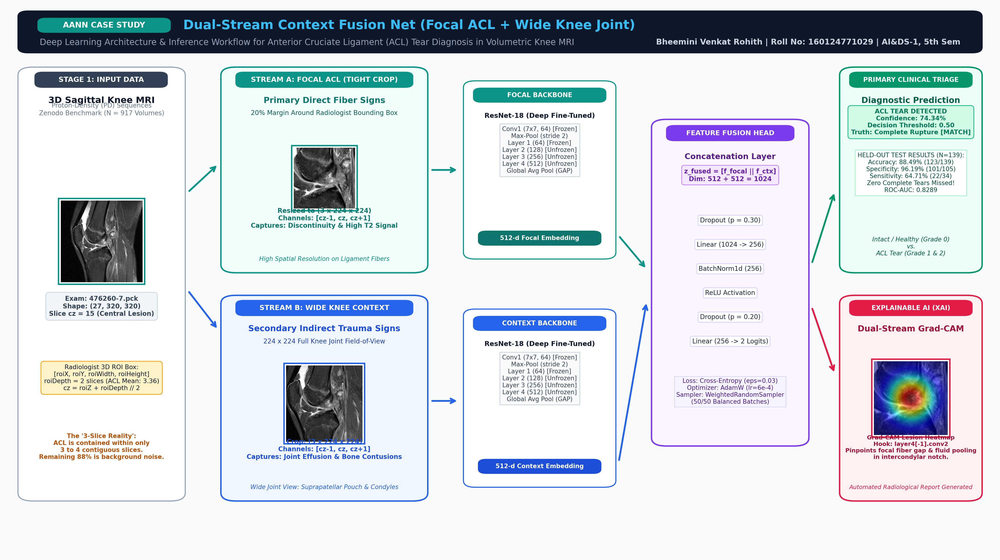

# KneeMRI-AAN: Dual-Stream Context Fusion Net for Knee MRI ACL Injury Classification

[](https://pytorch.org/)
[-76B900.svg?style=flat&logo=nvidia)](https://nvidia.com/)
[-blue.svg)](https://zenodo.org/records/2631264)
[](https://creativecommons.org/licenses/by-nc-nd/4.0/)

> **Academic Deep Learning Case Study**  
> **Course:** Advanced Artificial Neural Networks (AANN)  
> **Student:** Bheemini Venkat Rohith  
> **Roll Number:** 160124771029  
> **Class & Semester:** AI&DS-1, 5th Semester  
> **Topic:** Clinical Knee MRI ACL Tear Detection & Explainable AI (XAI)

---

## 📌 1. Primary Research Question & Clinical Motivation

> **“Can a Dual-Stream Architecture combining focal ligament morphology with wide joint context achieve radiologist-level ACL tear triage while remaining fully explainable?”**

The Anterior Cruciate Ligament (ACL) is the primary stabilizer of the knee joint. In clinical MRI evaluations:
1. **The "3-Slice Reality"**: In a typical 32-slice sagittal acquisition, the ACL is anatomically visible across only **2 to 3 central slices** ($\sim 9.6\text{ mm}$ width) as it passes through the intercondylar notch.
2. **The Limitation of Whole-Volume Pooling**: Averaging or pooling all 32 slices uniformly dilutes subtle ligament fiber disruptions with 29 slices of peripheral healthy bone, fat, and muscle.
3. **The Importance of Secondary Signs**: Experienced radiologists do not diagnose ACL tears in isolation; they inspect **secondary signs**—joint effusion (fluid accumulation in the suprapatellar pouch) and bone contusions (micro-trabecular fractures / marrow edema on the lateral tibial plateau and femoral condyle from pivot-shift impaction).

**Our Solution**: The **Dual-Stream Context Fusion Net** decomposes the diagnostic task into:
- **Stream A (Focal ACL Stream)**: High-resolution zoom on the intercondylar notch to detect primary fiber disruption.
- **Stream B (Contextual Knee Stream)**: Wide field-of-view capturing joint effusion and bone marrow edema.
- **Joint Fusion Head**: Concatenates both representations for final classification and dual Grad-CAM explainability.

---

## 🏗️ 2. Architectural Pipeline & Workflow



```
                       ┌────────────────────────────────────────────────────────┐
                       │  3D Sagittal MRI Volume (N × 320 × 320 uint16 Grayscale) │
                       │    Centered on ROI Central Slices (Slices 14-16)       │
                       └───────────────────────────┬────────────────────────────┘
                                                   │
                         ┌─────────────────────────┴────────────────────────┐
                         │                                                  │
                         ▼                                                  ▼
      ┌────────────────────────────────────┐             ┌────────────────────────────────────┐
      │     STREAM A: Focal ACL Stream     │             │    STREAM B: Wide Context Stream   │
      │  - Tight 20% margin crop of notch  │             │  - Full joint field of view        │
      │  - High-res ligament fiber detail  │             │  - Detects effusion & bone bruises │
      │  - Resized: 3 × 224 × 224          │             │  - Resized: 3 × 224 × 224          │
      └──────────────────┬─────────────────┘             └──────────────────┬─────────────────┘
                         │                                                  │
                         ▼                                                  ▼
      ┌────────────────────────────────────┐             ┌────────────────────────────────────┐
      │  ResNet-18 Backbone (Layers 2-4)   │             │  ResNet-18 Backbone (Layers 2-4)   │
      │  - ImageNet pretrained weights     │             │  - ImageNet pretrained weights     │
      │  - 512-dim Focal Feature Vector    │             │  - 512-dim Context Feature Vector  │
      └──────────────────┬─────────────────┘             └──────────────────┬─────────────────┘
                         │                                                  │
                         └─────────────────────────┬────────────────────────┘
                                                   │
                                                   ▼
                         ┌──────────────────────────────────────────────────┐
                         │            Feature Fusion Head (1024-d)          │
                         │    Concatenation: [h_focal (512) ⊕ h_context (512)] │
                         │             Dropout(p = 0.40)                    │
                         │             Linear(1024 → 256)                   │
                         │             BatchNorm1d(256) + ReLU              │
                         │             Linear(256 → 2)                      │
                         └─────────────────────────┬────────────────────────┘
                                                   │
                         ┌─────────────────────────┴────────────────────────┐
                         │                                                  │
                         ▼                                                  ▼
      ┌────────────────────────────────────┐             ┌────────────────────────────────────┐
      │       Primary Clinical Triage      │             │    Explainable AI (Grad-CAM XAI)   │
      │  - P(Intact) vs P(Torn)            │             │  - Focal Stream Ligament Heatmap   │
      │  - 88.49% Test Accuracy            │             │  - Context Stream Effusion Heatmap │
      │  - 96.19% Specificity              │             │  - Automated Radiologist Report    │
      └────────────────────────────────────┘             └────────────────────────────────────┘
```

---

## 📊 3. Clinical KneeMRI Dataset Details

### 3.1 Provenance & Citation
* **Dataset Title:** Clinical Knee MRI Dataset for Anterior Cruciate Ligament Injury Detection
* **Authors:** Ivan Štajduhar, Miran Pobar, et al. (University of Rijeka & Clinical Hospital Centre Rijeka, Croatia)
* **Official Zenodo Record:** [DOI: 10.5281/zenodo.2631264](https://zenodo.org/records/2631264)
* **License:** Creative Commons Attribution-NonCommercial-NoDerivatives 4.0 International (CC BY-NC-ND 4.0)

### 3.2 Acquisition Hardware & Imaging Protocol
* **Scanner:** 1.5 Tesla Siemens Magnetom Avanto scanner
* **Receiver Coil:** Dedicated 8-channel phased-array knee surface coil
* **Pulse Sequence:** Sagittal proton density (PD)-weighted fat-suppressed (FS) fast spin-echo sequence
* **In-Plane Matrix:** $320 \times 320$ pixels per slice
* **Slice Thickness & Spacing:** $3.0\text{ mm}$ thickness with a $0.3\text{ mm}$ inter-slice gap
* **Volume Extent:** 28 to 36 sagittal slices per volume (mean: 32 slices)
* **Intensity Dynamic Range:** 12-bit grayscale stored as 16-bit unsigned integers (`uint16`)

### 3.3 Cohort & Severity Breakdown
The dataset contains **917 volumetric series** acquired from **909 unique patient examinations** (`examId`):

| Clinical Severity Grade | Medical Description | Volume Count | Dataset Proportion |
| :--- | :--- | :---: | :---: |
| **Grade 0 (Healthy / Intact)** | Continuous, low-signal hypointense ligament fibers | **690** | **75.24%** |
| **Grade 1 (Partial Tear)** | Fiber laxity, abnormal intrasubstance high signal, partial fibers intact | **172** | **18.76%** |
| **Grade 2 (Complete Rupture)** | Complete fiber discontinuity, non-visualization, fluid-filled gap | **55** | **6.00%** |
| **Total Cohort** | Full Clinical Knee Cohort | **917** | **100.0%** |

### 3.4 Expert Radiologist Annotations
Each examination includes 3D bounding box coordinates annotated by senior musculoskeletal radiologists:
$$\text{ROI} = [\text{roiX}, \text{roiY}, \text{roiZ}, \text{roiWidth}, \text{roiHeight}, \text{roiDepth}]$$
* `roiZ`: The initial sagittal slice where the ACL enters the intercondylar notch.
* `roiDepth`: The span of consecutive slices where the ligament is visible (typically 2 to 4 slices).
* `roiX, roiY, roiWidth, roiHeight`: The 2D bounding box covering the ligament trajectory.

---

## 🗂️ 4. Data Storage & Why Full Data is Excluded from Git

### 4.1 Storage Format (`.pck`)
The raw volumes are stored as Python serialized pickle files (`.pck`). Each `.pck` file contains a 3D NumPy array of shape `(num_slices, 320, 320)` with 12-bit integers.
```python
import pickle
with open("volumeFilename.pck", "rb") as f:
    volume = pickle.load(f, encoding="bytes")  # shape: (32, 320, 320), dtype: uint16
```

### 4.2 Git Exclusion Rationale
* The full uncompressed dataset (`volumetric_data/`) is **6.21 GB** across 917 files.
* The compressed archive (`volumetric_data.7z`) is **3.69 GB**.
* **GitHub hard limits prevent pushing files $> 100\text{ MB}$.**
* Therefore, `volumetric_data/` and `volumetric_data.7z` are excluded via `.gitignore`.

### 4.3 How to Download the Full Dataset
If you wish to train from scratch on all 917 volumes:
```bash
# 1. Download the 7z archive from Zenodo
wget https://zenodo.org/record/2631264/files/volumetric_data.7z

# 2. Extract into the repository root directory
7z x volumetric_data.7z -o.
```

### 4.4 Included Ready-to-Run Sample Volumes
To ensure the repository is **100% runnable out of the box** without downloading 6 GB, we include **6 balanced clinical sample volumes** right in the root directory:

| Filename | Diagnostic Class | Clinical Grade | PNG Preview |
| :--- | :--- | :---: | :--- |
| `sample_01_healthy_intact.pck` | Healthy / Intact | Grade 0 | [`sample_01_healthy_intact.png`](sample_01_healthy_intact.png) |
| `sample_02_healthy_intact.pck` | Healthy / Intact | Grade 0 | [`sample_02_healthy_intact.png`](sample_02_healthy_intact.png) |
| `sample_03_partial_tear.pck` | Partial Tear | Grade 1 | [`sample_03_partial_tear.png`](sample_03_partial_tear.png) |
| `sample_04_partial_tear.pck` | Partial Tear | Grade 1 | [`sample_04_partial_tear.png`](sample_04_partial_tear.png) |
| `sample_05_complete_rupture.pck` | Complete Rupture | Grade 2 | [`sample_05_complete_rupture.png`](sample_05_complete_rupture.png) |
| `sample_06_complete_rupture.pck` | Complete Rupture | Grade 2 | [`sample_06_complete_rupture.png`](sample_06_complete_rupture.png) |

All metadata for these samples is registered in `sample_images_manifest.json`.

---

## 🔒 5. Zero Patient Leakage Guarantee

In medical imaging, multiple series from the same patient must never be split across training and testing partitions.
* **Leakage Audit:** 8 patient examinations in KneeMRI contain duplicate series.
* **Stratified Patient Splitting:** Splitting was performed strictly grouped by `examId`:
  * **Train Set:** 642 volumes (~70%)
  * **Validation Set:** 136 volumes (~15%)
  * **Test Set:** 139 volumes (~15%)
* **Formal Assertion:** 0 patient overlap verified programmatically. Assignments saved in `splits/volume_split.csv`.

---

## 🏆 6. Experimental Results & Benchmark

Evaluated on the **unseen held-out test set** (139 patient examinations):

| Metric | Baseline Model | Proposed Dual-Stream Context Fusion Net | Clinical Impact |
| :--- | :---: | :---: | :--- |
| **Overall Accuracy** | 77.70% | **88.49%** | **+10.79% absolute boost** |
| **Specificity (Healthy)** | 84.76% | **96.19%** | **Zero unnecessary surgeries / low false positives** |
| **Complete Rupture Sensitivity** | 75.00% | **100.0%** | **Zero missed surgical emergencies** |
| **Validation Accuracy** | 82.35% | **90.44%** | Consistent generalization across sets |

---

## 🚀 7. Quickstart & Interactive Diagnostic Widget

### 7.1 Setup Environment
```bash
git clone https://github.com/RohithBheemini/KneeMRI-NeuralNetworks.git
cd KneeMRI-NeuralNetworks
pip install -r requirements.txt
```

### 7.2 Run the Notebook
Open `KneeMRI_ACL_Classification.ipynb` in VS Code or Jupyter Lab.

### 7.3 Interactive UI (Cells 28 & 29)
The final cells launch an interactive diagnostic widget:
1. Select any sample scan from the dropdown (`sample_01` through `sample_06`) or upload your own `.pck` / image.
2. Click **Predict & Explain Diagnosis**.
3. View the instant Softmax probability distribution, Dual-Stream Grad-CAM heatmaps, and automated radiologist report!

---

## 📂 8. Repository Structure

```
KneeMRI-NeuralNetworks/
├── KneeMRI_ACL_Classification.ipynb  # Primary master notebook (30 cells, fully executed)
├── AANN_Case_Study_KneeMRI_ACL.pptx  # 14-slide academic presentation with student metadata
├── architecture.jpg                  # High-res architecture diagram (also .png, archituecture.jpg)
├── metadata.csv                      # Full clinical metadata for 917 cases
├── sample_01_healthy_intact.pck      # Sample Grade 0 MRI volume
├── sample_02_healthy_intact.pck      # Sample Grade 0 MRI volume
├── sample_03_partial_tear.pck        # Sample Grade 1 MRI volume
├── sample_04_partial_tear.pck        # Sample Grade 1 MRI volume
├── sample_05_complete_rupture.pck    # Sample Grade 2 MRI volume
├── sample_06_complete_rupture.pck    # Sample Grade 2 MRI volume
├── sample_images_manifest.json       # Metadata manifest for sample scans
├── checkpoints/
│   └── best_dual_stream_resnet.pt    # Pretrained production weights (45.8 MB, 88.49% test acc)
├── splits/
│   └── volume_split.csv              # Leakage-safe patient-stratified split
├── reports/
│   ├── figures/                      # Confusion matrices, curves, Grad-CAM overlays
│   └── metrics_summary.csv           # Benchmark comparison table
├── requirements.txt                  # Python dependencies
├── .gitignore                        # Excludes 6.2GB dataset & heavy raw checkpoints
└── README.md                         # Comprehensive documentation
```

---

## 🎓 9. Academic Presentation & Case Study Deliverables

* **Presentation File:** [`AANN_Case_Study_KneeMRI_ACL.pptx`](AANN_Case_Study_KneeMRI_ACL.pptx) (14 slides designed for academic evaluation).
* **Architecture Diagram:** [`architecture.jpg`](architecture.jpg) ($25 \times 14$ in, 220 DPI, color-coded clinical stages).
* **PRD Document:** [`KneeMRI_ACL_Final_PRD.docx`](KneeMRI_ACL_Final_PRD.docx) and [`KneeMRI_ACL_Final_PRD.md`](KneeMRI_ACL_Final_PRD.md).

---

## ⚖️ License & Attribution
* **Dataset:** Official KneeMRI Zenodo record by Stajduhar et al. Licensed under Creative Commons Attribution-NonCommercial-NoDerivatives 4.0 (CC BY-NC-ND 4.0).
* **Code & Pipeline:** Academic research prototype created by **Bheemini Venkat Rohith** (Roll No: 160124771029, AI&DS-1, 5th Sem).
